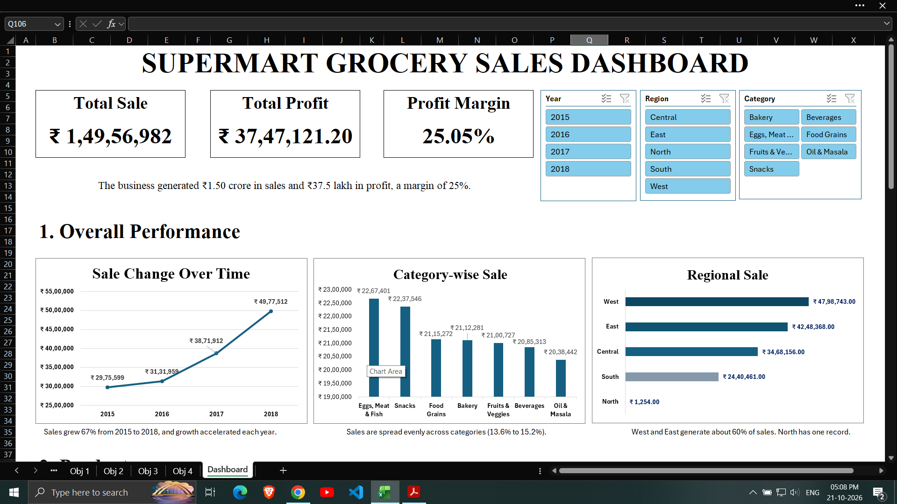
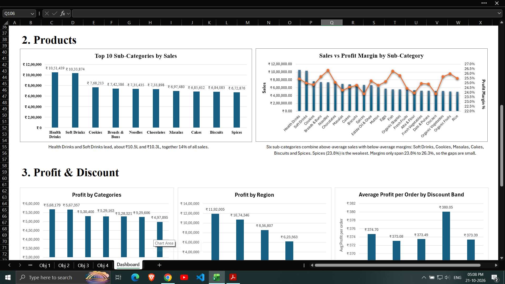
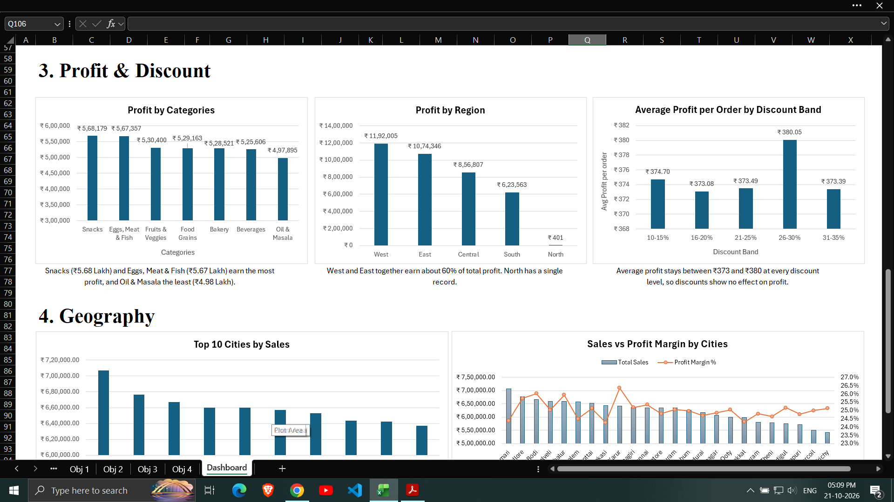
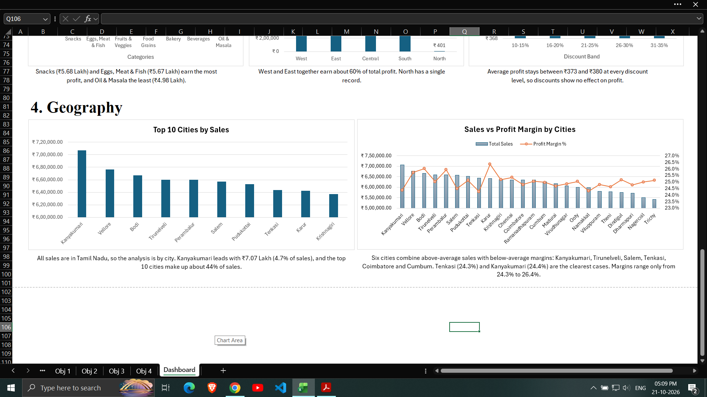
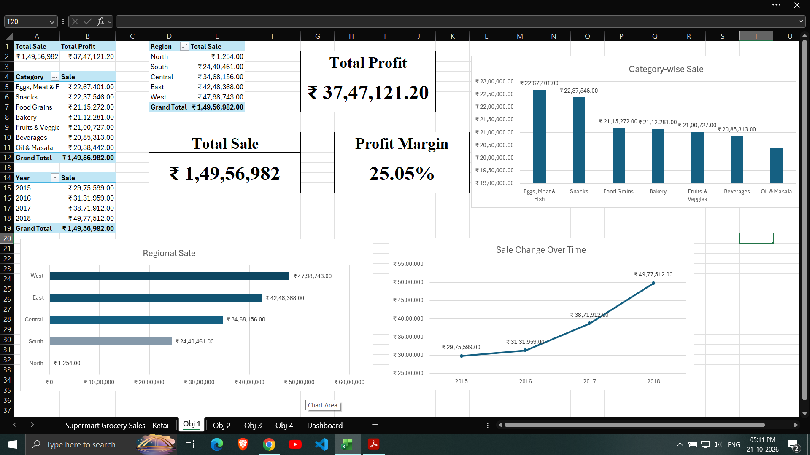
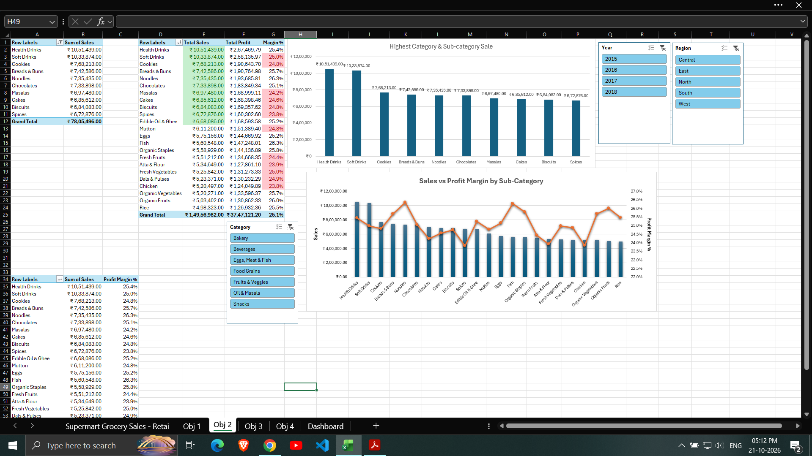
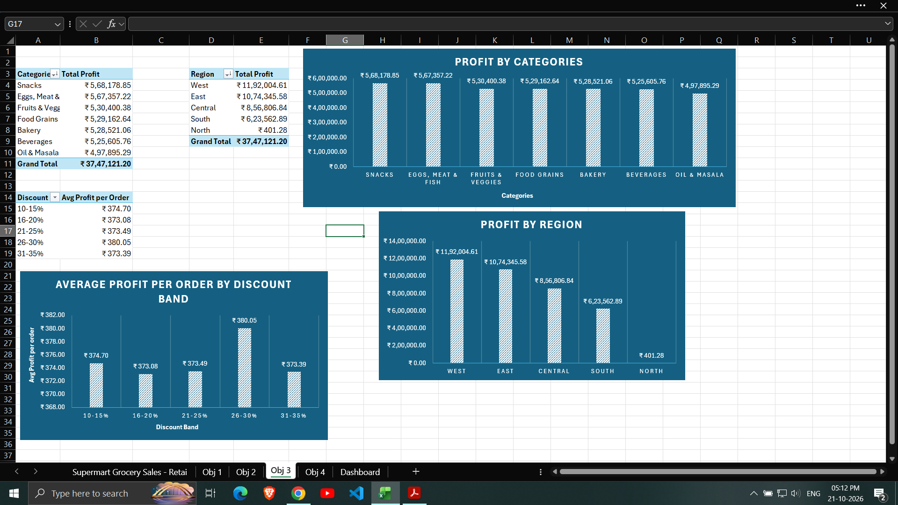
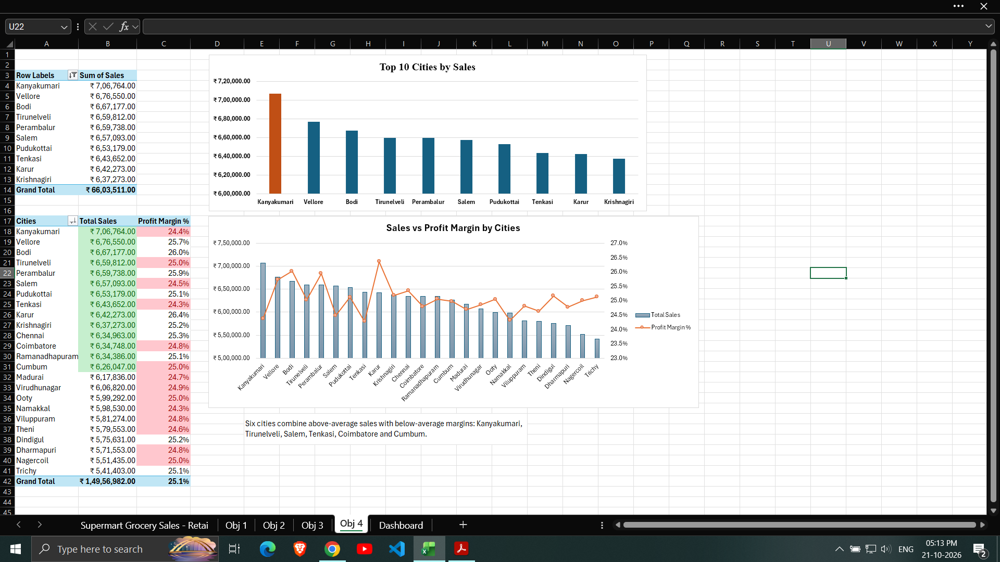
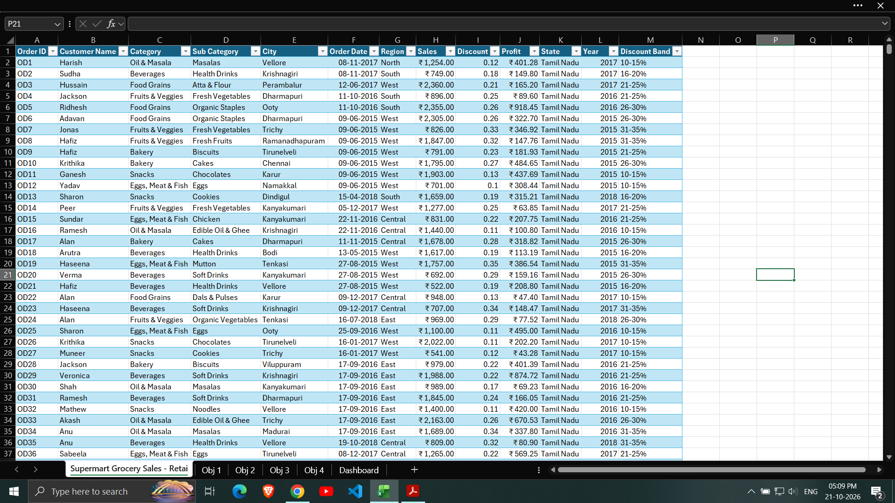

# 🛒 Supermart Grocery Sales Dashboard — Excel

An interactive Microsoft Excel dashboard for analyzing grocery sales, profitability, product performance, discount patterns, and geographic trends.

Created by: Aditya Jain
Tools: Microsoft Excel | PivotTables | PivotCharts | Slicers

## 📌 Project Overview

This project transforms **9,994 grocery order records spanning 2015–2018** into an interactive sales analytics dashboard. It helps management evaluate business performance, identify high-performing product categories and locations, and investigate the relationship between sales, profit, and discounts.

Built using Excel Tables, PivotTables, PivotCharts, calculated fields, conditional formatting, and interactive slicers, the dashboard brings important business metrics together in one place.

**Project type:** Data Analytics | Business Intelligence | Excel Dashboard


## 🖼️ Dashboard Preview

### Executive Dashboard









### Objective 1 — Overall Sales Performance



### Objective 2 — Product Performance



### Objective 3 — Profit and Discount Analysis



### Objective 4 — Geographic Performance



### Dataset Preview



## 🎯 Business Objectives

| Objective | Business Question |
|---|---|
| 1. Overall Sales Performance | How is the business performing over time, across categories, and across regions? |
| 2. Product Performance | Which product sub-categories generate the highest sales, and which combine high sales with lower profit margins? |
| 3. Profit & Discount Analysis | How do profitability and discount levels relate to business performance? |
| 4. Geographic Performance | Which cities contribute most to sales, and how do their profit margins compare? |

## 📊 Dashboard Features

### 1. Overall Sales Performance
- KPI cards for Total Sales, Total Profit, and Profit Margin.
- Year-wise sales trend from 2015 to 2018.
- Category-wise sales comparison.
- Regional sales performance.

### 2. Product Performance
- Top 10 sub-categories ranked by sales.
- Sales and profit-margin comparison by sub-category.
- Identification of sub-categories with above-average sales and below-average profit margins.

### 3. Profit & Discount Analysis
- Profit comparison across product categories.
- Regional profit analysis.
- Average profit per order across discount bands.
- Analysis of the relationship between discount levels and profitability.

### 4. Geographic Performance
- Top 10 cities by sales.
- Sales and profit-margin comparison by city.
- Identification of high-sales cities with below-average profit margins.

### Interactive Filtering
The dashboard includes three slicers:
- **Year**
- **Region**
- **Category**

The slicers are connected to the dashboard's PivotTables and charts, allowing users to filter multiple views together.

## 🔍 Key Findings

### Overall Performance

- **Total Sales:** Approximately ₹1.50 crore.
- **Total Profit:** Approximately ₹37.47 lakh.
- **Profit Margin:** 25.05%.
- Sales increased from approximately ₹29.76 lakh in 2015 to ₹49.78 lakh in 2018, representing growth of around 67%.
- Year-over-year sales growth accelerated from approximately 5.3% in 2016 to 23.6% in 2017 and 28.6% in 2018.
- Sales were distributed relatively evenly across the seven product categories, with category shares ranging from approximately 13.6% to 15.2%.
- The West and East regions together contributed approximately 60% of total sales.

### Product Performance

- **Health Drinks** generated approximately ₹10.51 lakh in sales, while **Soft Drinks** generated approximately ₹10.34 lakh. Together, they contributed around 14% of total sales.
- Six sub-categories combined above-average sales with below-average profit margins: Soft Drinks, Cookies, Masalas, Cakes, Biscuits, and Spices.
- Spices recorded the lowest sub-category profit margin at approximately 23.8%.
- Profit margins across sub-categories ranged from approximately 23.8% to 26.3%, indicating relatively small differences.

### Profit & Discount Analysis

- Snacks and Eggs, Meat & Fish were among the most profitable categories, generating approximately ₹5.7 lakh each.
- Oil & Masala recorded the lowest category profit, at approximately ₹4.98 lakh.
- The West and East regions together generated around 60% of total profit.
- Average profit per order remained between approximately ₹373 and ₹380 across the discount bands.
- The analysis showed effectively zero correlation between discount level and profit, suggesting no clear linear relationship in this dataset.

### Geographic Performance

- All records are associated with Tamil Nadu, so geographic comparisons are conducted at the city level rather than the state level.
- **Kanyakumari** led the cities in sales, generating approximately ₹7.07 lakh, or 4.7% of total sales.
- The top 10 cities accounted for approximately 44% of total sales.
- Six cities combined above-average sales with below-average profit margins: Kanyakumari, Tirunelveli, Salem, Tenkasi, Coimbatore, and Cumbum.
- City-level profit margins ranged from approximately 24.3% to 26.4%.

## 🛠️ Tools & Techniques

**Microsoft Excel**

- Excel Tables for a structured data source.
- PivotTables for summarizing sales and profit.
- PivotCharts for visual analysis.
- Calculated fields for profit-margin analysis.
- Combo charts with secondary axes.
- Interactive slicers and PivotTable Report Connections.
- Conditional formatting to highlight business performance.
- Helper columns for grouping discounts into bands.
- KPI cards and dashboard layout design.

## 📁 Repository Structure

```text
supermart-grocery-sales-dashboard/
│
├── README.md
├── Supermart_Grocery_Sales_Dashboard.xlsx
│
└── images/
    └── dashboard.png
```

**Workbook contents:**
- Raw dataset.
- PivotTables supporting the analysis.
- Dashboard and supporting objective sheets.

## 🚀 How to Use

1. Download `Supermart_Grocery_Sales_Dashboard.xlsx` from this repository.
2. Open the workbook in the desktop version of Microsoft Excel.
3. Navigate to the dashboard sheet.
4. Use the **Year**, **Region**, and **Category** slicers to filter the analysis.
5. Select multiple slicer items where needed, using `Ctrl` for multi-selection.
6. Use the `Obj 1` to `Obj 4` sheets to inspect the supporting PivotTables and calculations.

**Note:** Microsoft Excel desktop is recommended for the interactive slicers and full workbook functionality. Other spreadsheet applications may not preserve all interactive features.

## ⚠️ Data Notes & Limitations

- **Single-state dataset:** All records identify Tamil Nadu as the state. Therefore, state-level comparisons are not meaningful, and the geographic analysis focuses on cities.
- **North region:** This region contains only one record, with ₹1,254 in sales. This may indicate a data-quality issue, so it is excluded from the main regional conclusions.
- **Discount patterns:** All orders have discounts between 10% and 35%. The nearly flat relationship between discounts and profit may reflect how the dataset was generated and should not automatically be generalized to real retail operations.
- **Product detail:** The dataset does not contain individual product names. Product-level analysis therefore uses sub-categories.
- **Static insights:** Narrative insight captions describe the overall dataset and do not dynamically change with slicer selections.
- **Profit margin:** Calculated as Total Profit divided by Total Sales. The dashboard's high-sales, low-margin classification uses above-average sales and below-average profit margin.

## 💡 What This Project Demonstrates

This project demonstrates the use of Excel for business-oriented data analysis, including:

- Turning raw transactional data into actionable business metrics.
- Building interactive dashboards for management reporting.
- Comparing sales performance with profitability.
- Identifying product and geographic performance patterns.
- Investigating discounts and their relationship with profit.
- Communicating findings and data limitations clearly.

## 👤 Author

Developed by Aditya Jain as a data analytics project.

**Data Analytics Portfolio Project**

Created using Microsoft Excel.

---

*This project is intended for learning and portfolio demonstration. Findings are based on the supplied dataset and should be interpreted in light of its limitations.*
